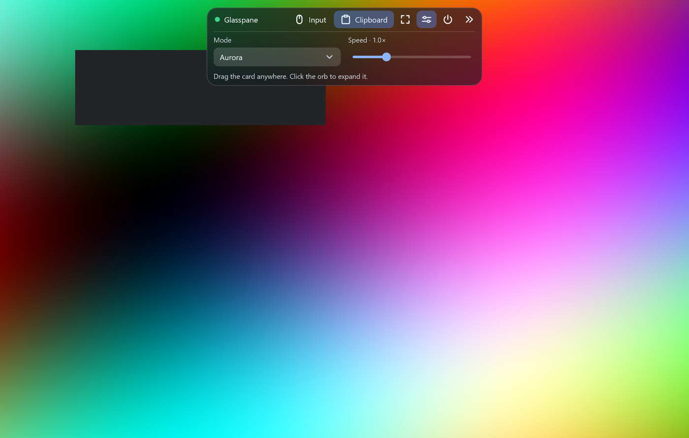

# Glasspane

Native Windows glass UI for apps whose main content is a live picture: a frosted-glass floating panel, an orb it collapses into, and a few controls, drawn over your video in one Direct2D pass. No WPF, no Avalonia, no Skia. NativeAOT friendly.



*The demo: a synthetic animated frame with a settings card. The card blurs the live frame behind it.*

## What it is

- **Win32 + Direct3D 11 + Direct2D + DirectWrite**, through [Vortice.Windows](https://github.com/amerkoleci/Vortice.Windows). A flip-model swap chain, one `ID2D1DeviceContext`, one render thread.
- **`UiVideoView`** uploads BGRA frames, draws them letterboxed, lets you paint overlays in the same pass, presents, and confirms GPU completion of every new frame.
- **Real frosted glass**: the frame behind the card is blurred by Direct2D and clipped to a rounded rectangle (`UiVideoView.DrawGlass`). For a window floating over the desktop, `UiBackdrop` grabs the pixels behind it and blurs those instead. Both work for any shape and any window size, unlike DWM acrylic.
- **`UiGlassPanel`**: a draggable card that collapses into an orb or a pill with an animation, can auto-collapse when idle, and hands hit-testing back to your window.
- **A small control set**: `UiButton` (plain, toggle, icon, danger), `UiSlider`, `UiChoice` (dropdown), `UiLabel`, tooltips, and a vector icon set you can extend with `UiPaint.RegisterIcon`.
- **NativeAOT ready**: `[UnmanagedCallersOnly]` window procedure, no reflection, no XAML. The demo publishes to a single ~3 MB exe with no .NET runtime installed.
- **Per-monitor DPI**, native move/size, full screen, exclude-from-capture.

## What it is not

A general-purpose toolkit. There is no layout engine, rich text, accessibility tree or data binding. You lay out your own panel (see `samples/GlassDemo/DemoPanel.cs`, about 100 lines). If you need forms and grids, use WPF or WinUI; if your UI is "the picture, plus a toolbar that floats on it", this is the right size.

## Quick start

Requires Windows 10 or later and the .NET 10 SDK.

```csharp
using Glasspane;

UiThread.Initialize();
using var window = new MyWindow();   // derive from UiWindow
return UiThread.Run();
```

```csharp
sealed class MyWindow : UiWindow
{
    readonly object sceneGate = new();
    readonly UiVideoView preview;
    readonly MyPanel panel;               // derive from UiGlassPanel

    public MyWindow()
    {
        CreateNative("My app", WS_OVERLAPPEDWINDOW | WS_CLIPCHILDREN, 0, unchecked((int)0x80000000), unchecked((int)0x80000000), 1100, 700);
        panel = new MyPanel(sceneGate);
        panel.Backdrop = (paint, rect, radius, _) => preview.DrawGlass(paint, rect, radius);   // frosted glass over the frame
        preview = new UiVideoView(this) { DrawOverlay = (paint, w, h) => panel.Draw(paint) };
        preview.Start();
        Show();
    }

    public void OnFrame(byte[] bgra, int width, int height) =>
        preview.Submit(new VideoFrame(bgra, width, height, Pts: 0));
}
```

`samples/GlassDemo` is the complete, runnable version, including pointer routing, the 10-second idle auto-collapse and the collapse/expand animation.

```powershell
dotnet run -c Release --project samples/GlassDemo
dotnet run -c Release --project samples/GlassDemo -- --settings   # start with the settings card open
dotnet publish samples/GlassDemo -c Release -r win-x64             # NativeAOT single exe
```

NativeAOT publishing needs the "Desktop development with C++" workload (and `vswhere` on `PATH`).

## Layout of the repo

| Path | Contents |
|---|---|
| `src/Glasspane` | the library |
| `samples/GlassDemo` | demo app and a reference panel |
| `docs` | the project page (GitHub Pages) |

## Origin

Glasspane is the UI layer of [FRD](https://github.com/KateY07/frd), a Windows remote-desktop component, extracted so that other apps can use it. FRD replaced Avalonia with it and went from a 29 MiB framework-dependent exe to an 11 MB NativeAOT exe.

## Notes

- Windows only, x64.
- `UiWindow.ExcludeFromCapture()` sets `WDA_EXCLUDEFROMCAPTURE`, so screen capture (including your own app's desktop capture) does not see the window. It is opt-in; set `GLASSPANE_ALLOW_CAPTURE=1` to make the call a no-op, which is handy for screenshots.
- The API is `0.x`: expect small breaking changes before 1.0.

## 中文简介

Glasspane 是面向 Windows 的原生 UI 库，适合“画面为主、控件悬浮其上”的应用（远程桌面、串流、录屏、监控）：深色毛玻璃悬浮面板、可折叠为悬浮球、图标按钮/开关/滑块/下拉框，全部由 Direct3D 11 + Direct2D + DirectWrite 在同一帧内绘制，不依赖 WPF、Avalonia、Skia，支持 NativeAOT（示例程序单文件约 3 MB）。毛玻璃由 Direct2D 对视频帧自绘模糊，任意形状、任意窗口尺寸均可，不依赖 DWM 亚克力。它不是通用控件库：没有布局引擎、富文本和无障碍。

## License

[MIT](LICENSE). Vortice.Windows is MIT licensed too.
